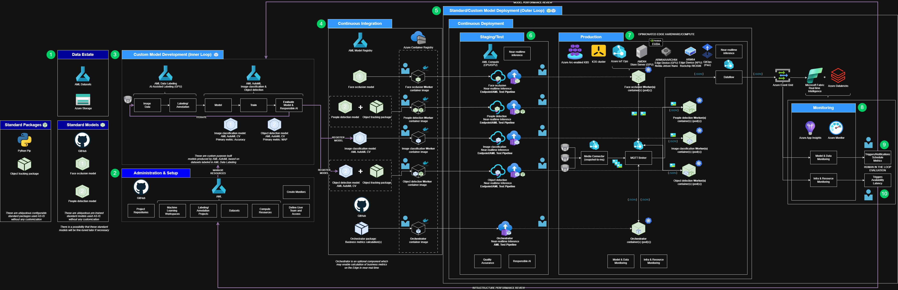

# Azure-HybridCloud-MLOps-ComputerVision
An opinionated and modern turn-key Machine Learning Computer Vision Reference Architecture and Implementation by ISE (Industry Solutions Engineering) Data Science based on [MLOps v2 project](https://github.com/Azure/mlops-v2) which takes advantage of [CAIRA](https://github.com/microsoft/CAIRA) (Composable AI Reference Architecture) and [Edge AI](https://aka.ms/edgeai) ISE accelerators for Hybrid Cloud scenarios.

## Pre-requisites

1. [CAIRA accelerator](https://github.com/microsoft/CAIRA)
2. [Edge AI accelerator](https://aka.ms/edgeai)

## Architecture

## Computer Vision Data Science Accelerator Value Proposition 

As a part of the design we outline the main principles of Business value & Technical strategy for Computer Vision Data Science Accelerator.

### People-centric & object-centric use cases

As informed by many ISE customers there's a number of ubiquitous Computer Vision (CV) use cases we can prioritize. People-centric use cases focus on analyzing people in the scene, in zones, etc. Object-centric use cases often times deal with detecting, tracking and/or classifying smaller custom objects. The lower-level data obtained with object detection, object tracking and image classification algorithms typically is used to produce higher-level business value (business intelligence, business metrics, business indicators, etc.) depending on the nature of the business.  

### Edge / Cloud

To satisfy near real-time inference and low latency requirements for running Computer Vision (CV) workloads, be able to optimize cost of the solution, and considering the experiences from production deployments of similar solutions in the industry, the decision has been made to implement Computer Vision (CV) inference on the Edge and train models in the Cloud leveraging Azure Machine Learning (AML) platform and MLOps practices.

### Traditional Machine Learning (ML) / Generative AI

While recent developments of multi-modal Generative AI LLMs (such as GPT4-Vision) or SLMs (such as Phi4-Vision) show promise for complex scene understanding and advanced reasoning, to achieve near real-time inference speeds and to ensure scalability and adaptability of Computer Vision (CV) solution the decision has been made to leverage traditional supervised machine learning Convolutional Neural Nets (CNN) architectures, use standard already pre-trained models if possible following BYOM (Bring Your Own Model) approach, and build purpose-built models with Azure Machine Learning (AML) AutoML capability ([link](https://github.com/Azure/azureml-examples/blob/main/cli/jobs/automl-standalone-jobs/cli-automl-image-object-detection-task-fridge-items)) following BYOD (Bring Your Own Data) approach as necessary. We also see an opportunity for applying Generative AI to augment the existing Computer Vision (CV) solution in the future for non-real-time scenarios as informed by ISE customer engagements (Ecolab, Chevron, Fairlife, etc.).

### AML AutoML CV

Azure Machine Learning (AML) AutoML capability allows to focus on business data and data science experimentation for building purpose-built models without the need to write and maintain custom code for model training. AutoML already supports a number of State-of-the-art (SOTA) model architectures for Computer Vision (CV) object detection, image classification, etc. to choose from.  

### CPU / GPU

It’s an industry best practice to leverage hardware acceleration for near real-time Computer Vision (CV) scenarios to make sure that the inference is fast enough to support modeled business processes. Running inference on CPU is significantly slower (maybe x10+ times slower) than running inference on GPU. And while there’re some options for CPU-accelerated inference on the Edge, the decision has been made to leverage GPU-accelerated inference with the help of PyTorch Deep Learning (DL) framework and NVIDIA CUDA technology. This means using NVIDIA CUDA-compatible GPU(s) for near real-time inference on the Edge.  Also, it has been decided to use Azure GPU-enabled Compute and Azure Machine Learning (AML) platform for training models in the Cloud at scale and take full advantage of Cloud elasticity and enable fast iterations of model improvements.

### Inference / Fine-tuning

When it comes to selecting specific models suited for specific Computer Vision (CV) use cases, we first seek standard already pre-trained models available (to be used for inference as is) before building purpose-built models to minimize the number of customizations and their future maintenance. And while it’s possible to fine-tune standard models for novel domain(s) (or classes of objects), the decision has been made to build a few smaller purpose-built models instead which offers better separation of concerns, easier maintenance, and greater degree of adaptability and manageability for the overall solution architecture.

### MLOps practices

It’s an industry best practice to follow proven MLOps practices for development (inner loop) and deployment (outer loop) of Computer Vision (CV) models at scale. The decision has been made to use Azure Machine Learning (AML) platform and Azure DevOps Pipelines ([link](https://learn.microsoft.com/en-us/azure/machine-learning/how-to-setup-mlops-azureml)) or GitHub Actions ([link](https://learn.microsoft.com/en-us/azure/machine-learning/how-to-setup-mlops-github-azure-ml)) to implement the necessary MLOps pipelines for processes automation and repeatability. This approach will allow to scale the solution in an agile and adaptive manner with minimum manual overhead.

### Generalist models / Specialist models

While it’s possible to build one single ML model covering the entirety of the business depending on the customer project if multiple legal entities (LE) are involved, the decision has been made to build separate ML models per legal entity which allows to properly account for data ownership, confidentiality and data partitioning, and other aspects related to data usage. Note that Azure Machine Learning (AML) platform offers flexibility to manage datasets on the different levels to build models on the LE level if necessary.

### AI-assisted labeling

In supervised machine learning arguably the most tedious task is data labeling. Azure Machine Learning (AML) platform offers Data Labeling capability with AI-assisted labeling option. AI-assisted labeling feature allows to label only part of the dataset (smaller part) before the rest of the dataset (bigger part) will be labeled by the system (AI) based on what AI learned from your labeling patterns, later you can review the labels for accuracy. This approach allows to increase the quality and reduce the cost of labeling in continuous learning environments.

### AML Compute cluster standardization

Azure Machine Learning (AML) platform allows to conveniently standardize both training and evaluation pipelines to use the same Compute cluster(s) infrastructure. NC-series GPU-enabled compute supported by AML is ideal for training complex machine learning models and running AI applications. The NVIDIA GPUs provide significant acceleration for computations typically involved in deep learning and other intensive training tasks.

### Kubernetes (K8S)

Many of ISE customers consider leveraging Kubernetes (K8S) technology for a large-scale distributed deployment for Computer Vision (CV) workloads. That’s why we are designing the solution architecture with portability and scale in mind by containerizing Computer Vision (CV) workloads. This will allow to streamline CI/CD processes from developing models, testing models in the Cloud, if necessary, to deploying models for inference as custom workloads within Azure IoT Operations, to monitoring models and enabling feedback loops for improvements.

### Edge server / Edge device

Successful Computer Vision (CV) workloads deliver predictable inference accuracy and performance on the Edge. That's why it's really important to benchmark these metrics for select go-to models in the context of specific Edge compute for particular use cases. Note that Azure IoT Operations (AIO) as Azure Arc extension requires AMD64 device. Flux (GitOps) Azure Arc extension is an exception and can be installed on both AMD64 and ARM64 platforms. Also NVIDIA Jetson Orin devices have AARCH64 architecture which a specialized version of ARM64.

### Model licensing

When training Computer Vision (CV) models we need to be cognizant of the licensing implications. Most of YOLO-family of models on GitHub have AGPL3.0/GPL3.0 license mandating source disclosure which is not suitable for closed-source commercial products. However, there's also permissive Apache3 license alternatives such as YOLO-X or RT-DETR in GitHub. Models trained with Azure Machine Learning (AML) AutoML Computer Vision (CV) using PyTorch/TorchVision adhere to BSD3-Clause license making them suitable for closed-source commercial products.

### Responsible AI

As we help ISE customers building Computer Vision (CV) models we adhere to [Responsible AI Principles and Approach | Microsoft AI](https://www.microsoft.com/en-us/ai/principles-and-approach).

## References

Reference to MLOps v2 accelerator [here](https://learn.microsoft.com/en-us/azure/architecture/ai-ml/guide/machine-learning-operations-v2#machine-learning-cv-architecture) and CV demo [here](https://github.com/Azure/mlops-v2-cv-demo)

Reference to AML component-based pipelines [here](https://learn.microsoft.com/en-us/azure/machine-learning/concept-component?view=azureml-api-2)

